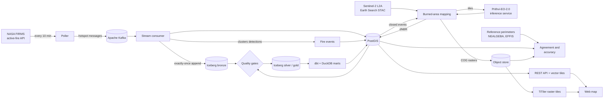
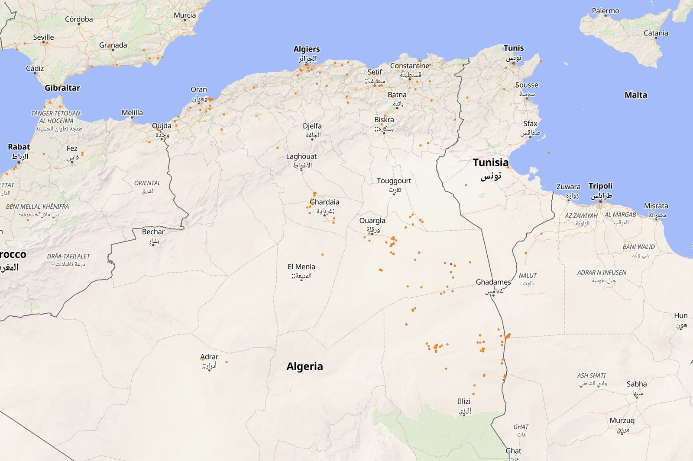
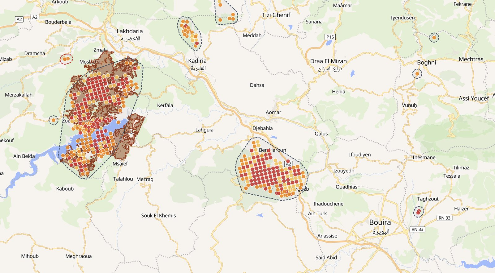
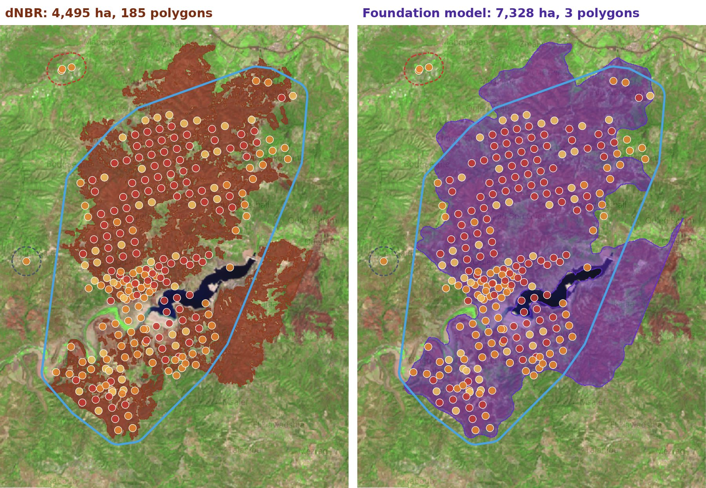
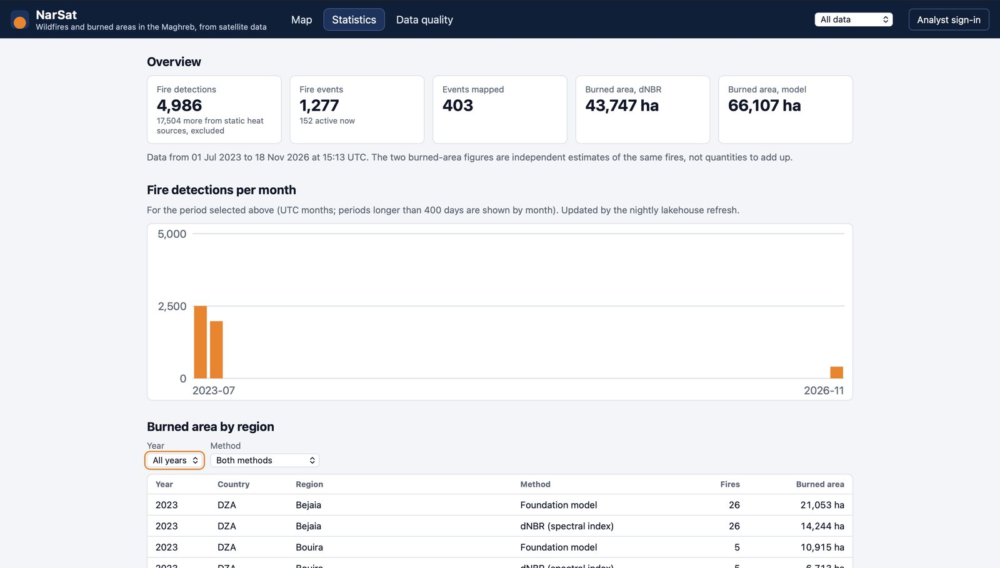
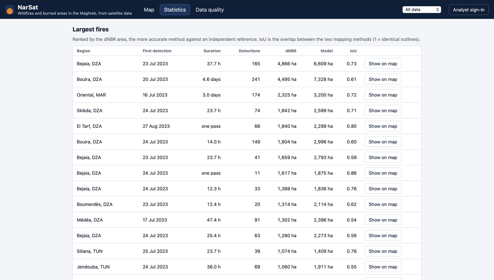
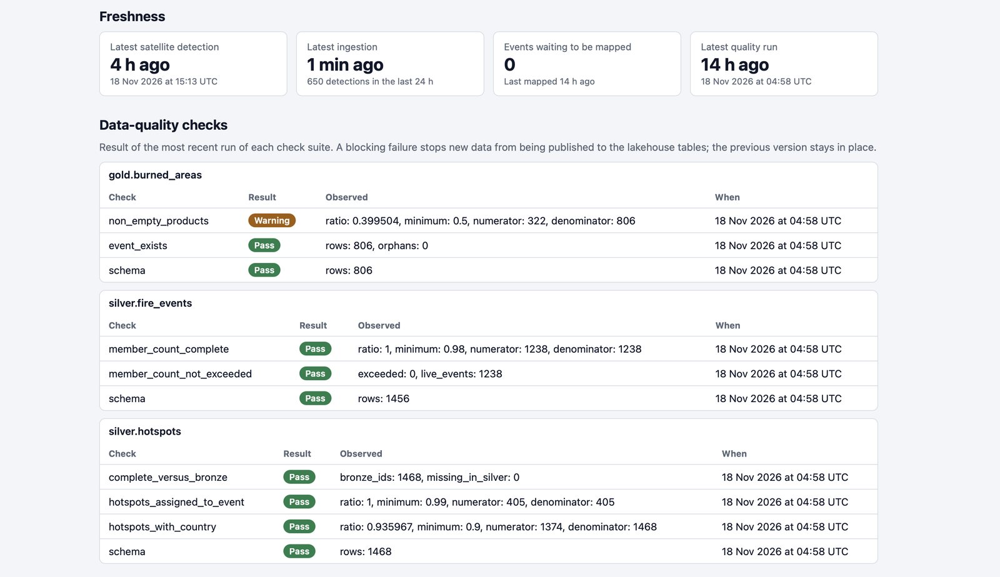
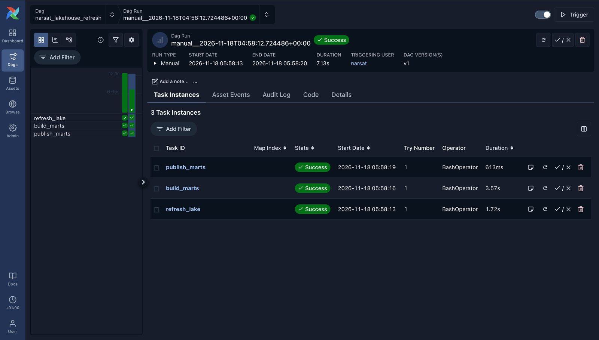

# NarSat

[](https://github.com/TMW17/narsat/actions/workflows/ci.yml)
[](LICENSE)


**Wildfires and burned areas in the Maghreb, from satellite data, as a streaming and
batch lakehouse.**

NarSat follows active fires over Morocco, Algeria and Tunisia from NASA FIRMS detections,
groups them into fire events, maps the burned area of each event from Sentinel-2 imagery
with two independent methods (a spectral index and a geospatial foundation model),
checks the data at every layer, and serves the result through a REST API and an
interactive map.

> **Status: version 0.1, run end to end on real data.** In November 2026 the whole
> platform ran on a MacBook Pro (Apple Silicon, 16 GB) on live NASA FIRMS data and on
> the July–August 2023 fire season. It mapped 403 fires with both methods and was
> evaluated against an independent published reference. Every number below comes from
> that run; the full tables, dates and settings are in [docs/results.md](docs/results.md).


---

## Results in brief

| What was run | Result |
| --- | --- |
| Backfill, VIIRS S-NPP, 1 July–31 August 2023 | 20,784 detections; 16,305 (78 %) recognised as static heat sources (gas flares, industry) and excluded |
| Fire events queued for mapping | 403 (Algeria 288, Morocco 63, Tunisia 52) |
| Mapping with both methods, unattended | 402 mapped in one run of 3 h 12 min (28.5 s per event); the one failure, an interrupted image read, mapped on the next run |
| Accuracy against NEALGEBA (independent Landsat reference, 63 events, 19,399 ha) | **dNBR: precision 0.765, recall 0.821, IoU 0.656, Dice 0.792**. Foundation model: precision 0.573, recall 0.837, IoU 0.516, Dice 0.680 |
| Lakehouse refresh, quality gates, dbt, Airflow | All tables rebuilt; no blocking failure, one explained warning; `dbt build` PASS=50 WARN=0 ERROR=0; Airflow run 7.1 s |
| Code checks | 273 Python tests and 32 web tests pass; `mypy --strict` and ruff clean |

**Main finding:** on these Algerian fires, the classic spectral index (dNBR) maps burned
areas more accurately than a foundation model fine-tuned on United States burn scars.

- **The model finds about the same burned area as dNBR, plus a lot that did not burn.**
  Its recall is only 1.6 points higher (306 ha more found), for 7,204 ha more false
  positives.
- **Its extra area has no burn signal for the most part.** A pixel-level comparison over
  236 events shows that 64 % of the model's extra area was bare before the fire or did
  not change. The rest is a weak signal that NEALGEBA mostly does not confirm either.
- **Gating helps, but not enough.** Keeping only the model pixels where dNBR shows
  change removed 4,448 ha of false positives and only 139 ha of true positives. It
  raised the model's precision from 0.573 to 0.678, still below dNBR.

The evaluation plan (maps, zone, measures) was written down before the reference was
loaded, and all four maps it named are reported.

---

## What it does



1. **Ingestion (streaming).** A poller queries the FIRMS area API for the VIIRS and MODIS
   near-real-time products and publishes each new detection to Kafka once. A consumer
   validates the messages (invalid ones go to a dead-letter topic with the reason),
   appends them to the bronze Iceberg table **exactly once** (the Kafka offsets are
   committed in the same Iceberg snapshot as the rows) and stores them in PostGIS.
2. **Fire events.** Detections are clustered in space and time (ST-DBSCAN: 2 km, 72 h).
   Each event keeps a stable identity as it grows, merges or splits. Persistent heat
   sources such as gas flares are recognised and excluded. Events are attributed to a
   country and a first-level unit (wilaya, region, governorate).
3. **Burned-area mapping (batch).** Once an event has been quiet for three days, the
   pipeline finds the best clear pre-fire and post-fire Sentinel-2 scenes and maps the
   burned area twice:
   * **dNBR**: the differenced Normalized Burn Ratio, thresholded automatically (Otsu,
     bounded), with vegetation, water and cloud masks;
   * **Prithvi-EO-2.0-300M-BurnScars**, a geospatial foundation model (IBM / NASA,
     Apache-2.0), run by a separate inference service.

   Network reads are retried with back-off, and every product records its images,
   thresholds and model version.
4. **Evaluation.** The two products are compared with each other and with reference
   perimeters:
   * `narsat map compare` explains, pixel by pixel, why the two maps disagree;
   * `narsat map evaluate` scores them against a reference such as NEALGEBA;
   * `narsat reference agreement` stores per-event agreement, shown in the map's panel.

   Neither method is assumed correct.
5. **Lakehouse and analytics.** Silver and gold Iceberg tables are rebuilt nightly
   behind blocking quality gates (Pandera). dbt builds analytics marts over them with
   DuckDB, and the marts are published to PostgreSQL for the API.
6. **Serving.** A FastAPI service exposes events, products, statistics, data-quality
   results and Mapbox vector tiles. TiTiler renders the Sentinel-2 rasters. A React and
   MapLibre application puts it together, with a review workflow for analysts.

---

## Results

### Live detections

The live feed polls FIRMS every ten minutes. This view shows the detections over the
Maghreb in November 2026, as received. Persistent heat sources, such as the gas flares
of the Algerian Sahara, are recognised from their history and kept out of the fire
events.



### One fire, two methods: Bouira, 20–25 July 2023

The first burned-area map: the dNBR product over the fire's 241 detections, with the
reservoir inside the fire correctly left out.



The same fire mapped by both methods, on the post-fire Sentinel-2 image in SWIR false
colour. The two maps share the same outer edge. The model fills in the patches that
dNBR leaves out, and it also covers the bare shore of the reservoir.



`narsat map compare --all` classifies every pixel that only the model calls burned,
over 236 events:

| Class | Share of the model's extra area |
| --- | --- |
| Unchanged (dNBR below 0.10) | 45.4 % |
| Low severity (dNBR 0.10–0.27) | 24.5 % |
| Bare, sparse or water before the fire | 18.3 % |
| dNBR between 0.27 and the event's threshold | 8.7 % |
| Above the threshold, removed as small or distant patches | 2.1 % |
| No clear view | 1.0 % |

On the 24 events where only the model found a burn, 99.4 % of its area is bare or
unchanged ground: false positives.

### Accuracy against an independent reference

The reference is **NEALGEBA v1.0**, a Landsat burned-area product for north-east Algeria
by Kouachi et al. (2024, CC BY 4.0). Its 2023 layer covers six wilayas (Annaba, Béjaïa,
El Tarf, Jijel, Skikda, Tizi Ouzou). The comparison is pixel by pixel on the 20 m event
grids. Pixels shared by overlapping events are counted once.

| Map | Precision | Recall | IoU | Dice |
| --- | --- | --- | --- | --- |
| **dNBR** | **0.765** | 0.821 | **0.656** | **0.792** |
| Foundation model | 0.573 | 0.837 | 0.516 | 0.680 |
| Model gated by dNBR change | 0.678 | 0.830 | 0.595 | 0.746 |
| dNBR or gated model | 0.660 | **0.851** | 0.592 | 0.744 |

On each of the 15 events with the most reference burned area, dNBR has the best or
equal-best IoU. Examples: 0.89 for the El Tarf fire of 27 August, 0.82 and 0.72 for two
of the Bejaia fires of 23–24 July, and 0.79 for Skikda.

Limits of this comparison:

- NEALGEBA is another satellite product, not ground truth. Its authors report errors
  below 8.2 % against Sentinel-2 references.
- It is annual and is matched by place only.
- Recall covers only the fires NarSat detected, and it is a lower bound: the event
  grids include corners the maps never cover (see [docs/results.md](docs/results.md)).

### Statistics, data quality and orchestration

The Statistics page reads the dbt marts. Fires are ranked by dNBR area, the more
accurate method.





The Data quality page shows the freshness of each stage and the latest result of every
check. The one warning flags a real finding: only 40 % of the mapped products contain
burned area, because many detected fires leave no scar of 1 ha or more.



Airflow runs the nightly lakehouse job: refresh behind the quality gates, `dbt build`,
then publish the marts.



---

## Technology

| Concern | Choice | Why |
| --- | --- | --- |
| Messaging | Apache Kafka 4 (KRaft) | Open source (Apache-2.0); no ZooKeeper |
| Object storage | SeaweedFS (S3 API) | Apache-2.0, actively maintained, runs on arm64 |
| Table format | Apache Iceberg (PyIceberg, SQL catalog) | ACID snapshots, time travel, no catalog server to run |
| Operational store | PostgreSQL 18 + PostGIS 3 | Spatial queries, vector tiles (`ST_AsMVT`) |
| Transformations | dbt Core + DuckDB | SQL marts with tests, in-process engine |
| Data quality | Pandera + custom gates | Results stored in the database, blocking or warning |
| Orchestration | Apache Airflow 3 | Scheduling and retries; DAGs only call the CLI |
| Imagery | STAC (pystac-client), rasterio / GDAL | Cloud-Optimized GeoTIFFs read by HTTP range requests |
| Model | TerraTorch + Prithvi-EO-2.0 | Published burn-scar fine-tune |
| API | FastAPI, psycopg 3 | Async, typed, OpenAPI |
| Map | React, MapLibre GL, TiTiler | Open-source web mapping and dynamic raster tiles |
| Monitoring | Prometheus, Grafana | Alerts on freshness, lag, quality failures |

The reasons behind these choices, and the weaknesses of the original design they fix,
are in [docs/architecture.md](docs/architecture.md) and the
[architecture decision records](docs/adr/).

---

## Quick start

**Requirements:**

- Docker with Compose v2 and BuildKit (the `buildx` plugin), with 8 GB of memory for
  the core platform. On macOS, Colima works:
  `brew install colima docker docker-compose docker-buildx`, then
  `colima start --cpu 4 --memory 8 --disk 100`.
- A free [NASA FIRMS MAP_KEY](https://firms.modaps.eosdis.nasa.gov/api/map_key/).

```bash
git clone https://github.com/TMW17/narsat.git && cd narsat
cp .env.example .env          # fill in the values marked "required"; never commit .env
docker compose up -d --build  # core platform
open http://localhost:8080    # web application
```

On Apple Silicon, run the foundation model natively on the GPU (MPS) rather than in a
container; see [services/inference/README.md](services/inference/README.md).

```bash
docker compose --profile orchestration up -d --build   # Airflow at http://localhost:8081
```

| Address | Service |
| --- | --- |
| http://localhost:8080 | Web application |
| http://localhost:8000/docs | REST API (OpenAPI) |
| http://localhost:8081 | Airflow (profile `orchestration`) |
| http://localhost:3000 | Grafana (profile `observability`) |

### Reproducing the results

The full procedure, with every command, is in [docs/operations.md](docs/operations.md).
In short:

```bash
# boundaries, then the 2023 season (or trigger the narsat_firms_backfill DAG)
for c in DZA MAR TUN; do for l in 0 1; do
  docker compose exec api narsat reference load-admin --iso3 $c --level $l; done; done
docker compose exec api narsat firms backfill --source VIIRS_SNPP_SP --start 2023-07-01 --end 2023-08-31
docker compose exec api narsat events update
docker compose exec api narsat map pending --limit 500     # both methods: NARSAT_SEG_METHODS=dnbr,model
docker compose exec api narsat map compare --all
# NEALGEBA: see docs/operations.md, "NEALGEBA, an open reference for north-east Algeria"
docker compose exec api narsat map evaluate --source nealgeba \
    --admin1 '^(b[eé]ja[iï]a|skikda|el.?tarf|jijel|annaba|tizi.?ouzou)$'
docker compose exec -T postgis psql -U narsat -d narsat < analysis/mapping_summary.sql
```

---

## Repository layout

```
src/narsat/            the platform (Python package and `narsat` command line)
  ingestion/           FIRMS client, poller
  streaming/           Kafka producer and consumer, exactly-once sink
  events/              ST-DBSCAN clustering, event identity, static heat sources
  imagery/             STAC search, COG reading, spectral indices
  segmentation/        dNBR method, inference client, post-processing
  pipeline/            event mapping, comparison, evaluation, agreement, lake refresh, marts
  lake/                Iceberg catalog, bronze/silver/gold tables, maintenance
  quality/             data contracts and quality gates
  reference/           administrative boundaries and reference perimeters
  api/                 FastAPI application
  db/                  PostgreSQL access and migrations
services/inference/    model-serving service (PyTorch, TerraTorch)
transform/             dbt project (marts)
orchestration/dags/    Airflow DAGs
analysis/              SQL used for the results
web/                   React + MapLibre application, nginx configuration
infra/                 PostGIS, TiTiler and Airflow images, Prometheus, Grafana
tests/                 unit, integration and end-to-end tests
docs/                  architecture, decisions, operations, results, validation report
```

## Development

```bash
make install            # Python environment (uv) and web dependencies
make lint               # ruff, mypy --strict, TypeScript and ESLint
make test               # unit tests
make test-integration   # needs PostgreSQL/PostGIS and an S3 store, see docs/development.md
```

See [docs/development.md](docs/development.md) for running the parts without Docker and
for the end-to-end browser test. What was tested, where, and what was found and fixed on
the first real run is in [docs/validation-report.md](docs/validation-report.md).

## Data sources and licences

NarSat's code is under the Apache License 2.0. The data it processes keeps its own
terms, summarised in [docs/data-sources.md](docs/data-sources.md). No downloaded data is
stored in this repository.

| Source | Use | Terms |
| --- | --- | --- |
| NASA FIRMS (VIIRS, MODIS) | Active-fire detections | NASA open data; acknowledged on the map |
| Copernicus Sentinel-2 L2A via Earth Search (Element 84) | Pre- and post-fire imagery | Free and open; products contain modified Copernicus Sentinel data |
| Prithvi-EO-2.0-300M-BurnScars (IBM, NASA) | Burn-scar segmentation | Apache-2.0 |
| geoBoundaries (gbOpen) | Countries and first-level units | ODbL 1.0 for these three countries |
| NEALGEBA v1.0 | Reference for the accuracy evaluation | CC BY 4.0 |
| OpenFreeMap | Base map | © OpenStreetMap contributors (ODbL) |

**NEALGEBA citation:** Kouachi, M. E., Khairoun, A., Baeza, M. J., Moutahir, H. (2024).
NEALGEBA v1.0, burned areas of north-east Algeria 1984–2023 [data set], Zenodo,
https://doi.org/10.5281/zenodo.10684711. Paper: *Remote Sensing* 16(13), 2500.

## Limitations

* **The accuracy figures cover one region and one season,** north-east Algeria in
  July–August 2023, against a single Landsat reference. Morocco and Tunisia have not
  been evaluated against an independent reference yet.
* **The foundation model is used as published.** It was fine-tuned on burn scars in the
  United States and was not adapted to the region; its weaker precision here is a
  measured result, not a verdict on what a regionally adapted model could do.
* **Many small fires leave no mappable scar.** 167 of the 403 events had no burned
  patch of at least 1 ha according to either method. Agricultural burns and fires of a
  few hectares are near the limit of 20 m pixels.
* **FIRMS detections are thermal anomalies, not fires.** The static-source filter
  removes persistent ones, not every false alarm.
* **Mapping needs a clear post-fire Sentinel-2 image,** so an event can wait days for
  one.
* **The monitoring profile was not run** in the reported run (Prometheus and Grafana);
  its rules and dashboard are only checked by tests.

## Roadmap

See [docs/roadmap.md](docs/roadmap.md). The main items:

- dNBR burn-severity classes;
- EFFIS references for Morocco and Tunisia;
- fine-tuning the model on NEALGEBA's 1984–2022 maps, holding out 2023;
- a production deployment path.

## Licence

Apache License 2.0, see [LICENSE](LICENSE).

Built by Tadj Mohamed Walid ([@TMW17](https://github.com/TMW17)).
