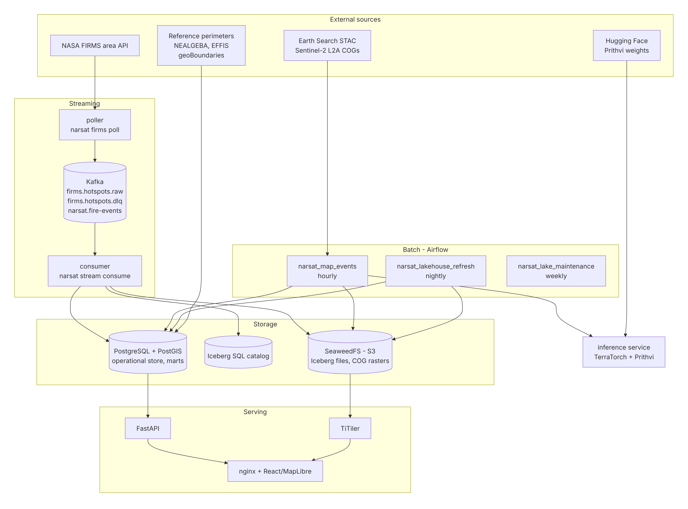

# Architecture

This document describes how NarSat is built and why. Individual decisions are recorded
in [adr/](adr/); what has actually been executed and tested is in
[validation-report.md](validation-report.md).

## 1. Requirements

| Requirement | Consequence for the design |
| --- | --- |
| Follow active fires over the Maghreb in near real time | Streaming ingestion from NASA FIRMS, events updated as detections arrive |
| Map the burned area of every significant fire | Batch pipeline per event, triggered once the fire is quiet |
| Use a geospatial foundation model, credibly | Model output always stored next to a classical baseline and compared, never trusted blindly |
| Lakehouse with quality control | Iceberg layers (bronze, silver, gold) behind blocking quality gates, results persisted |
| REST API and interactive map | FastAPI, vector and raster tiles, React/MapLibre |
| One developer, one laptop, no paid services | Open-source components only, profiles to start only what is needed, free data sources |
| Reproducible and honest | Locked dependencies, idempotent pipelines, synthetic test data clearly labelled as such |

## 2. Components

Diagram source: [diagrams/components.mmd](diagrams/components.mmd) (Mermaid).

| Component | Runs as | Role |
| --- | --- | --- |
| `poller` | long-running service | Polls each FIRMS product every 10 minutes (2-day window), publishes new detections once |
| `consumer` | long-running service | Validates, lands in bronze (exactly once) and PostGIS, updates events, publishes event changes |
| `api` | long-running service | REST API, vector tiles, platform-health metrics |
| `titiler` | long-running service | Renders the Cloud-Optimized GeoTIFFs of the lake as map tiles |
| `web` | nginx | Serves the application; the only public entry to `api` and `titiler` |
| Airflow | scheduler, API server, DAG processor | Runs the batch commands on a schedule, with retries |
| `inference` | optional service | Burn-scar probability from a reflectance cube |
| PostGIS, Kafka, SeaweedFS | infrastructure | State |

All pipeline logic lives in the `narsat` package and its command line. Airflow DAGs only
call commands such as `narsat map pending`; a failed task is reproduced by running the
same command in a shell.

## 3. Data flow and data model

### 3.1 Streaming path

1. The **poller** requests `/api/area/csv/{key}/{source}/{bbox}/{days}` for each product.
   Rows are parsed into `HotspotMessage`s with a deterministic identifier (UUIDv5 of
   instrument, satellite, acquisition time and position): the same detection seen in two
   polls has the same id. A detection is marked as seen only after Kafka acknowledged
   it, so a crash re-publishes rather than loses.
2. The **consumer** reads micro-batches (up to 2,000 messages or 15 s) and:
   * validates each message against the schema and the area of interest; failures go to
     `firms.hotspots.dlq` with the reason and the source position in headers;
   * appends the valid rows to `bronze.firms_hotspots` (see 3.3);
   * inserts them into PostGIS (`ON CONFLICT DO NOTHING` on the identifier);
   * re-clusters the affected time window and publishes created or changed events;
   * commits the Kafka offsets last.

### 3.2 Fire events

Detections are clustered with **ST-DBSCAN** (haversine distance 2 km, time 72 h,
`min_samples` 1, so an isolated detection is an event of one). Clustering is recomputed
over a sliding 10-day window, which raises the question of identity: after recomputing,
which cluster is "the same" event as before? NarSat identifies each event by its **seed
detection** (the earliest member) and reconciles new clusters with existing events:

* a cluster containing the seed of one existing event continues that event;
* a cluster containing seeds of several events merges them into the oldest; the others
  are marked `merged` with a pointer to the survivor;
* an existing event none of whose detections remain is `dissolved`.

These rules are property-tested with Hypothesis on random clustering runs: every
cluster gets exactly one identity, and re-running the reconciliation on unchanged data
changes nothing.

**Static heat sources.** Gas flares and industrial sites in the Algerian Sahara produce
detections on most days of the year. A 0.02-degree cell detected on at least 10 distinct
days in 60 is flagged persistent; its detections are excluded from events. FIRMS
standard-processing products also carry a `type` field (e.g. static land source) that is
used when present.

**Attribution.** An event belongs to the country and first-level unit containing its
centroid or, for a coastal fire whose centroid falls just offshore, to the nearest unit
within 0.05 degrees (about 5 km). Events without a country are retried at every update,
so boundaries can be loaded after the live feed has started.

**Status.** `active` (detection in the last 48 h) -> `cooling` (up to 3 days quiet) ->
`closed`. Closed events with at least two detections enter the mapping queue, unless they
lie outside the configured countries. The study area is a rectangle that also covers
parts of Spain, Portugal and Libya: once the boundaries of Algeria, Morocco and Tunisia
are loaded, an event in none of them is skipped.

### 3.3 Exactly-once landing in bronze

Kafka delivers at least once; an Iceberg append is not idempotent. NarSat applies the
technique of the Flink and Kafka Connect Iceberg sinks: **the Kafka offsets are written
into the summary of the Iceberg snapshot that contains the rows** (property
`narsat.kafka.offsets`). Rows and offsets become durable in one atomic commit. On
restart, the writer drops every message at or below the recorded offset of its partition.

Two refinements close the remaining gaps:

* the offsets are read again inside the commit, and Iceberg commits are compare-and-swap:
  if another writer committed in between, the commit fails and is retried against the
  new state;
* offsets are meaningful for one incarnation of a topic only. The Kafka topic identifier
  is stored next to them (`narsat.kafka.topic-ids`); if the topic is re-created (for
  example after its volume was deleted), the stale offsets are discarded instead of the
  new messages.

Weekly compaction rewrites each closed month of bronze into one file and carries both
properties forward.

### 3.4 Burned-area mapping

For each queued event (`narsat map pending`):

1. **Area and grid.** The detections' convex hull, buffered by 1.5 km, defines the area;
   a UTM grid at 20 m covers it (refused above 16 million pixels).
2. **Scenes.** Sentinel-2 L2A items are searched on Earth Search (`sentinel-2-c1-l2a`).
   The post-fire scene is the *earliest* scene at least one day after the last detection
   whose scene classification (SCL) leaves at least 70 % of the area clear; the pre-fire
   scene is the *latest* clear scene before the first detection, preferring the same
   relative orbit (same viewing geometry). If no post-fire scene is usable yet, the event
   waits (`imagery_pending`) and is re-examined twelve hours later. Once the 45-day
   post-fire window has closed, the clearest scene is accepted if at least 30 % of the
   area is clear, and the clear fraction is recorded with the product.
3. **dNBR.** NBR = (NIR - SWIR2) / (NIR + SWIR2) with B8A and B12, before and after;
   dNBR = NBR_pre - NBR_post. The threshold is computed with Otsu's method on the
   observed pixels and kept within [0.10, 0.44]; pixels that were not vegetated before
   (NDVI < 0.15), water (scene classification before the fire), cloud, cirrus, shadow,
   snow and saturated pixels are excluded. The "dark area" class is deliberately kept:
   Sen2Cor often labels fresh burn scars with it.
4. **Model.** The post-fire reflectance (six bands) is resampled to 30 m, sent to the
   inference service, and the probability raster brought back to 20 m; threshold 0.5.
5. **Post-processing**, identical for both methods: patches smaller than 1 ha and
   patches farther than 750 m from every detection of the event are removed. Holes are
   kept: unburned islands are real.
6. **Outputs.** Polygons in PostGIS (`burned_area`, one row per event and method, with the
   scene identifiers, threshold, clear fraction and parameters); COGs in the lake
   (pre/post reflectance, dNBR, masks, probability) with their footprint; the STAC items
   used, for provenance.
7. **Agreement.** IoU, precision and recall against reference perimeters overlapping the
   event, and between the two methods (`narsat reference agreement`). Where the methods
   disagree, `narsat map compare <id>` explains each disagreeing pixel from the stored
   rasters (bare before the fire, no clear view, unchanged, low severity, below the
   threshold, removed by cleaning).

### 3.5 Lakehouse layers and quality gates

| Layer | Tables | Built by |
| --- | --- | --- |
| bronze | `bronze.firms_hotspots` (append-only, partitioned by acquisition month) | stream consumer |
| silver | `silver.hotspots` (deduplicated, enriched with event, country, unit, static flag), `silver.fire_events` (snapshot) | nightly refresh, month by month (dynamic partition overwrite) |
| gold | `gold.burned_areas`, `gold.burned_area_validation` | nightly refresh |
| marts | `fire_activity_daily`, `burned_area_admin_year`, `event_summary` | dbt (DuckDB) -> Parquet -> PostgreSQL schema `mart` |

Every refresh runs check suites (`silver.hotspots`, `silver.fire_events`,
`gold.burned_areas`): schema contracts (Pandera), completeness against bronze,
referential integrity, ratios. A failed check of severity `error` stops the refresh
**before** the table is replaced, so consumers keep the last good version; `warn` results
are recorded only. All results go to `dq_result` and are visible on the data-quality page
and as Prometheus gauges. dbt adds its own tests on the marts (uniqueness of keys,
accepted values, and a reconciliation between the two burned-area marts).

### 3.6 Serving

* **API** (`/api/v1`): events (GeoJSON), event detail with products, agreement metrics
  and raster layers, statistics from the marts, data-quality results, vector tiles
  (`ST_AsMVT`, hotspots thinned to one per screen pixel below zoom 8). Writing endpoints
  (analyst review, re-mapping) need a token (Argon2id passwords, HS256 JWT, login
  throttling).
* **Raster tiles**: TiTiler reads the COGs from the object store. It is reachable only
  through nginx, which lets through exactly the query strings the API generates (a COG
  under `s3://narsat/assets/`, band indices, a value range, one of three colour maps).
  TiTiler itself would read any URL it is given; the allowlist prevents server-side
  request forgery.
* **Web application**: map with detections, event outlines and burned areas, satellite
  layers per event, statistics, data quality, analyst review.

## 4. Weaknesses of the initial design and what replaced them

The first design (from the project-selection research) was reviewed before
implementation. The table lists what changed and why.

| Initial proposal | Weakness | Implemented instead |
| --- | --- | --- |
| Redpanda | Business Source License: not open source | Apache Kafka 4 in KRaft mode ([ADR 0001](adr/0001-kafka-kraft.md)) |
| MinIO | Community edition repository archived in April 2026; no longer a safe base | SeaweedFS S3 gateway, storage-agnostic URIs ([ADR 0002](adr/0002-seaweedfs-object-storage.md)) |
| Iceberg REST catalog service | One more server to run and secure for a single developer | PyIceberg SQL catalog in PostgreSQL ([ADR 0003](adr/0003-iceberg-sql-catalog.md)) |
| `postgis/postgis` image | Published for x86-64 only: emulated on Apple Silicon | Own image from `postgres:18` + Debian PostGIS packages |
| Consumer writes to the lake with at-least-once delivery | Replays duplicate rows in an append-only table | Offsets committed inside the Iceberg snapshot, topic identity checked (3.3) |
| Clusters recomputed on each run | Event identifiers change, links from products break | Seed-based identity with merge/dissolve rules (3.2) |
| Model output as "the" burned area | A US-trained model, unvalidated in the Maghreb | dNBR baseline always computed; agreement stored and shown ([ADR 0006](adr/0006-two-methods-compared.md)) |
| Model inside the pipeline process | PyTorch stack conflicts with the rest; no GPU in Docker on macOS | Separate inference service with a `.npy` contract; can run natively with MPS ([ADR 0005](adr/0005-separate-inference-service.md)) |
| Next.js front end | Server rendering not needed; one more runtime to operate | Static React/Vite build behind nginx ([ADR 0007](adr/0007-static-spa-maplibre.md)) |
| Airflow tasks with pipeline code inline | Logic untestable outside Airflow; dependency conflicts | Thin DAGs calling the CLI in a separate virtual environment ([ADR 0004](adr/0004-thin-airflow-dags.md)) |
| Batch-job metrics pushed to Prometheus | Short-lived processes exit before being scraped | The API exports database-derived health gauges (freshness, queue, quality) |
| TiTiler exposed directly | Reads arbitrary URLs: server-side request forgery | nginx allowlist on the exact query string ([ADR 0008](adr/0008-tile-allowlist.md)) |

## 5. Failure behaviour

| Failure | Behaviour |
| --- | --- |
| FIRMS unavailable or key rate-limited | Retries with exponential back-off; the 2-day window recovers missed detections at the next successful poll; alert after one hour without success |
| Kafka unavailable | Poller keeps detections unmarked and re-publishes later; consumer resumes from committed offsets |
| Consumer crash mid-batch | Batch re-delivered; bronze skips what it holds, PostGIS ignores duplicates |
| Invalid message | Dead-letter topic with reason, never blocks the stream |
| Network hiccup while reading imagery (DNS lookup, reset connection, timeout, HTTP 429/5xx) | Each image read is retried four times with exponential back-off, catalogue searches five times; a missing file (404) fails at once |
| No clear post-fire image yet | Event waits in `imagery_pending`, re-examined every 12 h |
| Mapping error | Recorded on the event; retried up to 5 times, then `failed` (alert) |
| Inference service down | dNBR product still produced; model product missing for that event |
| Blocking quality check fails | Lake tables keep their previous version; alert; DAG run fails |
| Object store or database down | Services fail health checks and restart; nothing is half-written (Iceberg and PostgreSQL commits are atomic) |
